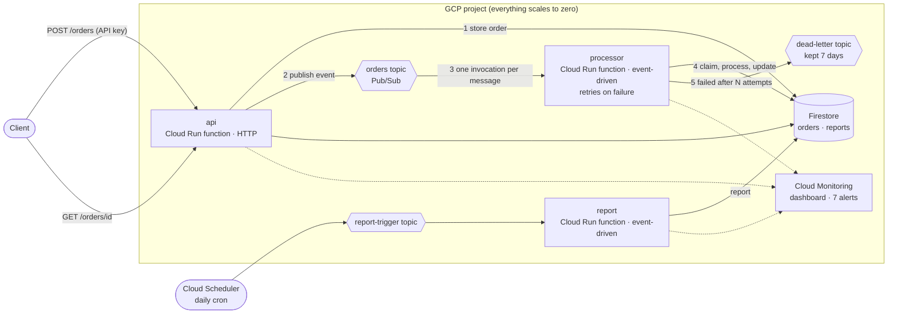

# Project 5 – Serverless Cloud Application Deployment (Google Cloud + Terraform)

An event-driven order-processing application built entirely from managed, serverless services: **Cloud Run functions**, **Pub/Sub**, **Firestore** and **Cloud Scheduler**. There are no servers to manage. It scales from zero to a configurable cap automatically, costs nothing while idle, retries failures and parks unprocessable orders in a dead-letter queue, and ships with a dashboard, alerts, a load test and full documentation.

One command (`terraform apply`) builds and deploys everything, including the Python code. One command (`terraform destroy`) removes it.

---

## Table of contents

1. [What it deploys](#1-what-it-deploys)
2. [Architecture](#2-architecture)
3. [How it meets the project requirements](#3-how-it-meets-the-project-requirements)
4. [Project structure](#4-project-structure)
5. [Prerequisites](#5-prerequisites)
6. [Deployment guide](#6-deployment-guide)
7. [Configuration reference](#7-configuration-reference)
8. [Try it: end-to-end demo](#8-try-it-end-to-end-demo)
9. [API](#9-api)
10. [Monitoring and alerts](#10-monitoring-and-alerts)
11. [Cost](#11-cost)
12. [Security](#12-security)
13. [Testing](#13-testing)
14. [Cleanup](#14-cleanup)
15. [Troubleshooting](#15-troubleshooting)
16. [Possible improvements](#16-possible-improvements)

---

## 1. What it deploys

57 resources in the default configuration, in four Terraform modules plus the application code in `app/`:

| Module | Resources | Purpose |
|---|---|---|
| **functions** | 3 Cloud Run functions, runtime and build identities with least-privilege roles, private source bucket | The application: an API, an event-driven worker and a scheduled report |
| **messaging** | 3 Pub/Sub topics, dead-letter subscription, Cloud Scheduler job | Decoupling, retries, dead-lettering and the schedule trigger |
| **data** | Firestore database (native mode) | Serverless storage for orders and reports |
| **monitoring** | 3 log-based business metrics, 7 alert policies, 1 dashboard, email channels | Reliability and visibility |
| *(root)* | Google API enablement, API key | Platform wiring |

## 2. Architecture



**How it works:** the API validates an order, stores it and publishes an event, then answers immediately. Pub/Sub triggers the worker once per order, which processes it idempotently and updates Firestore. If an order keeps failing it is retried, then moved to a dead-letter topic so it cannot block the queue. Details in [`docs/ARCHITECTURE.md`](docs/ARCHITECTURE.md).

## 3. How it meets the project requirements

| Requirement | How this project delivers it |
|---|---|
| **Efficient** – functions execute quickly with minimal resources | 256 MB instances and three small dependencies. Firestore and Pub/Sub clients are created **once per instance** and reused; cloud libraries are imported **lazily**. The API does one write and one publish per order and answers in milliseconds; slow work happens asynchronously in the worker. `scripts/load_test.py` measures p50/p95/p99 latency. |
| **Scalable** – handles growing load without manual intervention | Cloud Run adds and removes instances automatically per function, up to `max_instances`. Pub/Sub absorbs bursts between the API and the worker. Firestore scales on its own. No load balancer, auto-scaler or capacity to configure. The load test shows instances climbing and returning to zero. |
| **Cost-optimized** – resources consumed only during execution | **`min_instances = 0`: scale to zero**, so an idle application costs essentially nothing. A hard `max_instances` cap bounds the worst-case bill. Small memory, short timeouts, 30-day lifecycle on source archives, free-tier-friendly services. Cost levers are documented. |
| **Reliable** – error handling, logging and monitoring | Input validation with clear errors; **retries** on event failures; an **idempotent** worker (duplicates are harmless); **dead-letter** handling after `max_delivery_attempts`; HTTP 503 with `Retry-After` if the queue is down; structured JSON logs; a dashboard and **7 alert policies** with runbooks. 43 unit tests cover the logic. |
| **Well-documented** – architecture, deployment workflow, APIs and serverless configuration | [`docs/ARCHITECTURE.md`](docs/ARCHITECTURE.md) (event flow, decisions, serverless settings table), [`docs/API.md`](docs/API.md) (every endpoint, fields, errors, examples), [`docs/DEPLOYMENT_WORKFLOW.md`](docs/DEPLOYMENT_WORKFLOW.md) (pipeline, rollback, CI/CD), [`docs/OPERATIONS.md`](docs/OPERATIONS.md) (monitoring, runbooks, cost) and this README. |

## 4. Project structure

```
project-5-serverless-application-deployment/
├── README.md                      # this file
├── versions.tf                    # Terraform + provider version constraints
├── main.tf                        # APIs, key, module wiring
├── variables.tf                   # all inputs (with validation)
├── outputs.tf                     # API URL, key, topics, dashboard, summary
├── terraform.tfvars.example       # copy to terraform.tfvars and edit
├── .terraform.lock.hcl            # pinned provider versions (commit this)
├── .gitignore                     # keeps state, tfvars, build archives and credentials out of git
├── app/                           # the serverless application (Python 3.12)
│   ├── main.py                    # entry points: api, process_order, daily_report
│   ├── router.py                  # HTTP routing, auth, validation, errors
│   ├── processing.py              # worker: idempotency, retries, dead-lettering, report
│   ├── orders.py                  # order validation, totals, business rules
│   ├── adapters.py                # Firestore and Pub/Sub adapters (lazy imports)
│   ├── config.py, slog.py         # configuration and structured logging
│   └── requirements.txt
├── modules/
│   ├── functions/                 # the three functions, identities, IAM, source bucket
│   ├── messaging/                 # topics, dead-letter subscription, scheduler
│   ├── data/                      # Firestore database
│   └── monitoring/                # log metrics, alerts, dashboard
├── scripts/
│   ├── demo.ps1                   # end-to-end demo and smoke test
│   └── load_test.py               # load test: throughput, latency, scale-out
├── docs/
│   ├── ARCHITECTURE.md
│   ├── API.md
│   ├── DEPLOYMENT_WORKFLOW.md
│   └── OPERATIONS.md
└── tests/
    ├── python/                    # 43 unit tests of the application (no cloud needed)
    └── serverless.tftest.hcl      # 18 offline infrastructure tests (providers mocked)
```

## 5. Prerequisites

| Need | Notes |
|---|---|
| **Terraform ≥ 1.9** | [Install guide](https://developer.hashicorp.com/terraform/install) (Windows: `winget install Hashicorp.Terraform`). |
| **A GCP project with billing enabled** | Link a billing account in the [console](https://console.cloud.google.com). |
| **Google Cloud CLI (`gcloud`)** | [Install guide](https://cloud.google.com/sdk/docs/install). Used for login and the demo. |
| **Permissions** | `Owner` on the project. |
| **Python 3** | Only to run the unit tests and `load_test.py`. Not needed to deploy. |

## 6. Deployment guide

**1. Log in** (opens a browser each time)

```bash
gcloud auth login
gcloud auth application-default login
```

**2. Select your project**

```bash
gcloud config set project YOUR_PROJECT_ID
gcloud auth application-default set-quota-project YOUR_PROJECT_ID
```

**3. Configure**

```bash
cd project-5-serverless-application-deployment
cp terraform.tfvars.example terraform.tfvars      # PowerShell: Copy-Item terraform.tfvars.example terraform.tfvars
```

Edit `terraform.tfvars`: set `project_id` and `alert_emails = ["you@example.com"]`.

**4. Initialize and preview**

```bash
terraform init
terraform plan
```

You should see **57 resources to add** (58 with one alert email: each address adds a notification channel).

**5. Deploy**

```bash
terraform apply
```

Type `yes`. Expect **7–10 minutes**: waits for newly enabled APIs and IAM (deliberate, about 2 minutes in total) and Cloud Build compiling the three functions (3–5 minutes). The code in `app/` is zipped and deployed automatically; there is no separate build step.

**6. Get the URL and key**

```bash
terraform output api_url
terraform output -raw api_key
```

## 7. Configuration reference

All variables live in `variables.tf`. Only `project_id` is required.

| Variable | Default | Description |
|---|---|---|
| `project_id` | *(required)* | GCP project ID |
| `region` | `us-central1` | Region of the functions, Pub/Sub and the scheduler |
| `firestore_location` | *(region)* | Firestore location (region or multi-region like `nam5`) |
| `environment` | `dev` | `dev`, `staging` or `prod` |
| `name_prefix` | `serverless` | Name prefix (3–12 chars, lowercase) |
| `min_instances` | `0` | **0 = scale to zero** (no idle cost); 1 = no cold starts but always billed |
| `max_instances` | `10` | Hard cap per function (protects against runaway cost) |
| `memory_mb` | `256` | 128, 256, 512, 1024 or 2048 |
| `api_timeout_seconds` / `worker_timeout_seconds` | `30` / `120` | Run-time limits |
| `max_delivery_attempts` | `5` | Attempts before an order is dead-lettered |
| `report_schedule` / `report_time_zone` | `0 6 * * *` / `Etc/UTC` | Cron schedule of the report |
| `require_api_key` | `true` | Require `X-API-Key` on data routes |
| `allow_unauthenticated` | `true` | Reachable URL; `false` = Google identity token required |
| `alert_emails` | `[]` | Who receives alerts |
| `error_threshold_count` / `latency_threshold_ms` / `backlog_age_seconds` | `5` / `1500` / `600` | Alert thresholds |
| `extra_labels` | `{}` | Extra labels for all resources |

**Outputs:** `api_url`, `api_key` (sensitive), `project_id`, `region`, `function_names`, `orders_topic`, `dead_letter_topic`, `dead_letter_subscription`, `report_job`, `database`, `dashboard_url`, `alert_policy_names`, `notification_channels`, `serverless_summary`.

## 8. Try it: end-to-end demo

Wait about **2 minutes** after `apply`, then run the demo. It is also a smoke test: every step prints `PASS` or `CHECK`.

```powershell
powershell -ExecutionPolicy Bypass -File scripts\demo.ps1
```

| Step | What it shows |
|---|---|
| 1. Protected API | `/health` is public; `/orders` without the key is **401**; an invalid order is **400** with a clear message |
| 2. Event-driven flow | Three orders are created, then picked up and processed by the worker with the correct total (first order may take a few seconds: the worker starts from zero instances) |
| 3. Reliability | A `poison` order fails on purpose, is **retried**, ends as `failed`, and appears in the **dead-letter** topic |
| 4. Scheduled report | The Cloud Scheduler job is triggered on demand and `/report` returns aggregated counts |
| 5. Statistics | Orders per status |

**Prove it scales.** While it runs, open the dashboard (`terraform output dashboard_url`), then:

```powershell
python scripts\load_test.py --requests 300 --concurrency 20
```

It prints throughput and p50/p95/p99 latency. On the dashboard **Active instances** rises from 0 during the test and falls back to **0** afterwards, which is the serverless promise: capacity follows demand, and idle costs nothing.

**Console pages worth showing:** **Cloud Run** (three services), **Pub/Sub** (topics and the dead-letter subscription), **Firestore** (`orders` collection), **Cloud Scheduler**, **Monitoring → Dashboards** and **Alerting**, **Logging → Logs Explorer** (`jsonPayload.event="order_processed"`).

## 9. API

| Method | Path | Auth | Purpose |
|---|---|---|---|
| GET | `/health` | no | Liveness |
| POST | `/orders` | key | Create an order (processed asynchronously) |
| GET | `/orders` | key | List recent orders |
| GET | `/orders/{id}` | key | Get one order and its status |
| GET | `/stats` | key | Orders per status |
| GET | `/report` | key | Latest scheduled report |

Quick example:

```powershell
$url = terraform output -raw api_url
$key = terraform output -raw api_key
$body = @{ customer = "Alice"; items = @(@{ sku = "BOOK-1"; qty = 2; price_cents = 1500 }) } | ConvertTo-Json -Depth 5
Invoke-RestMethod -Method Post -Uri "$url/orders" -Headers @{ "X-API-Key" = $key } -ContentType "application/json" -Body $body
```

Fields, statuses, every error code and more examples: [`docs/API.md`](docs/API.md).

## 10. Monitoring and alerts

| Tier | Alert |
|---|---|
| **CRITICAL** | Order dead-lettered (failed every attempt) |
| **ERROR** | API server errors · orders waiting unprocessed too long · order stored but could not be queued |
| **WARNING** | API p95 latency · function memory above 85% (right-sizing) · unexpected error in a function |

The dashboard has a guide panel and twelve charts: request rate, errors, latency p50/p95, **active instances**, **billable instance time**, memory and CPU, orders received/processed/dead-lettered, and the queue backlog. Runbooks for each alert are in [`docs/OPERATIONS.md`](docs/OPERATIONS.md) and embedded in the alert emails.

## 11. Cost

Serverless billing is per request and per second of use, so an idle system costs essentially nothing and a demo costs **cents or nothing**: the free tiers of Cloud Run functions, Pub/Sub, Firestore, Cloud Scheduler and Cloud Build cover this project's usage. (Free-tier amounts change; check current pricing.) The levers are in [`docs/OPERATIONS.md`](docs/OPERATIONS.md): scale to zero (default), the `max_instances` cap, small memory, short timeouts and lean logging. The one thing that could cost real money is an unprotected, unbounded public endpoint, which is why the API key and the instance cap exist.

## 12. Security

| Control | Implementation |
|---|---|
| Authentication | `X-API-Key` on data routes (random 32 characters, constant-time comparison); optional Google identity (`allow_unauthenticated = false`) |
| Least privilege | Runtime identity: Firestore user, event receiver, log/metric writer, publisher on two topics only. Separate build identity. No primitive roles. |
| Input validation | Types, ranges and sizes checked; 64 KB limit; strict ID format |
| Safe errors | Unexpected failures return a generic 500; details stay in logs; the API key is never logged |
| Private source | Source bucket enforces public-access prevention |
| Secrets | `.gitignore` excludes state, tfvars and keys; the API key is a sensitive output |

For production move the API key into Secret Manager and put an API gateway or IAP in front of the API.

## 13. Testing

Two test suites, neither needs a GCP account:

```bash
# 1. The application (Python standard library only)
python -I -m unittest discover -s tests/python

# 2. The infrastructure (providers mocked)
terraform init -backend=false
terraform fmt -check -recursive
terraform validate
terraform test
```

| Suite | Count | Covers |
|---|---|---|
| `tests/python` | **43** | Validation of every field, totals, business rules, routing, authentication, 400/401/404/405/413/503 handling, listing and limits, **idempotent processing, retry, dead-lettering after max attempts, no reprocessing of dead-lettered orders**, the scheduled report |
| `tests/serverless.tftest.hcl` | **18** | Three functions (one HTTP, two event-driven), scale-to-zero and instance cap, small memory, retries, all alert policies and tiers, dashboard coverage, **every filter names a `resource.type`**, least-privilege identities, private source bucket, public/private API, input validation |

**Verified results:** `python -I -m unittest discover` → **43 passed**. `terraform fmt -check` clean, `terraform validate` successful, `terraform test` → **18 passed, 0 failed** (Terraform 1.17.1; `google` 6.50.0, `random` 3.9.1, `time` 0.14.2, `archive` 2.8.1). The Terraform tests caught a real bug in my first draft (a for_each depending on a value only known after apply), which I fixed. I also confirmed the tests are meaningful by temporarily making the functions always-on (`min_instances = 1`); the scale-to-zero test failed as expected, then I reverted it.

> The application tests prove the code's logic. The Terraform tests prove the infrastructure design is valid and enforced. Neither can prove that Google accepts every setting, that Cloud Build compiles the functions, or that IAM propagation timing works out. A real `terraform apply` and `scripts/demo.ps1` (section 8) do that.

## 14. Cleanup

```bash
terraform destroy
```

Type `yes`. The Firestore database is deleted with its data. The enabled Google APIs stay on by design. Alerts may briefly open incidents while resources disappear; they close on their own. To remove absolutely everything, delete the project: `gcloud projects delete YOUR_PROJECT_ID`.

## 15. Troubleshooting

| Symptom | Cause / fix |
|---|---|
| `API has not been used in project ... or it is disabled` | The API was just enabled and needs a minute. Re-run `terraform apply`. |
| Function build fails (`Build failed`) | Open **Cloud Build → History** for the log. Usually an IAM propagation delay (re-run `terraform apply`) or a dependency problem in `app/requirements.txt`. |
| `Error 409: Could not create bucket gcf-v2-sources-...` | Google creates one shared staging bucket per project and region on the first function deployment; two functions deploying at the same instant race for it. The project staggers the three deployments by 30 s to avoid this. If it still happens, just re-run `terraform apply` (the bucket now exists). |
| Log-alert error `Right-hand side functions are currently not supported` | `starts_with()` is not allowed in log-alert filters (it is in metric filters). Use an explicit list of names. Already fixed in this project and covered by a test. |
| `Permission denied` on Eventarc, Artifact Registry or Cloud Run during deploy | IAM lag. Wait a minute and re-run `terraform apply`. |
| `Error 409 ... already exists` after an interrupted run | A resource was created but not recorded. Delete it, or `terraform import` it, then re-run. |
| Firestore `already exists` or location error | Use a valid `firestore_location`; a project can only have one database per ID. |
| First request is slow | Cold start from zero instances. Expected; set `min_instances = 1` if it matters. |
| `401` | Missing or wrong `X-API-Key` header. `terraform output -raw api_key`. |
| HTML `403 Forbidden` from the URL | `allow_unauthenticated = false`, or the invoker binding has not propagated yet. |
| Orders stay `received` | The worker is not running: check the processor's logs and the Pub/Sub trigger. |
| Demo: dead-letter step shows `CHECK` | The message may not have arrived yet; wait 30 seconds and run `gcloud pubsub subscriptions pull SUBSCRIPTION --limit=5`. |
| Alert or dashboard creation error | Paste the full error to the maintainer; a Google filter or schema detail may need adjusting. |
| `gcloud` not found | Add the Cloud SDK `bin` folder to `PATH` or reopen the terminal. |

## 16. Possible improvements

- **Secret Manager** for the API key, and an **API Gateway** or IAP in front of the API.
- **Concurrency tuning** (several requests per instance) to cut cost further under steady load.
- **Native dead-letter policy and ordering** by pushing from a Pub/Sub subscription to Cloud Run directly.
- **CI/CD** with Cloud Build or GitHub Actions and Workload Identity Federation (the commands are already documented).
- **Cloud Tasks or Workflows** for multi-step order fulfilment.
- **Firestore security rules and client SDKs** if browsers or mobile apps should read data directly.
- **Remote Terraform state** in a Cloud Storage bucket for team use.
